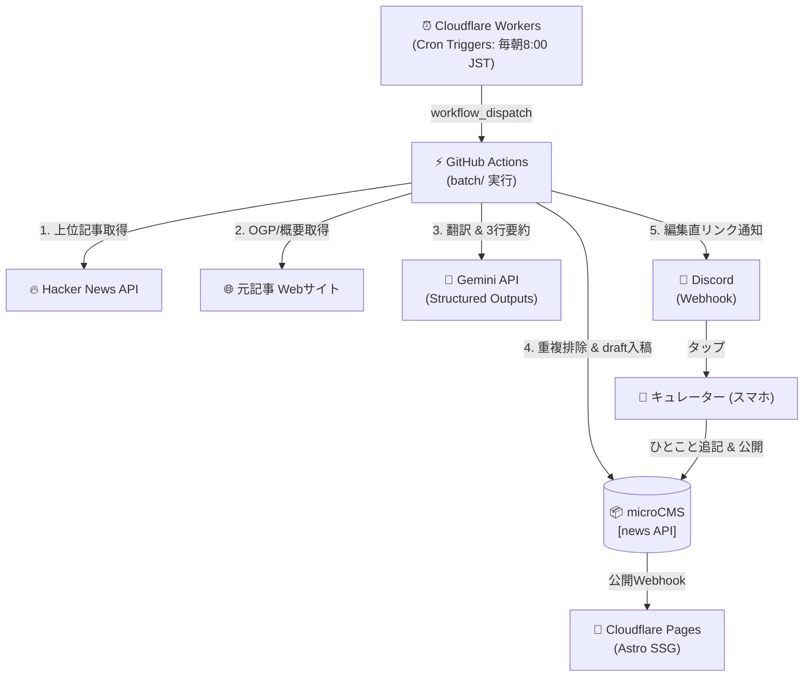

# Hacker news Hot Trends (`hnmc`)

**Hacker News API × Gemini API × microCMS × Astro × Cloudflare** で構築した、完全無料で運用できる半自動テックニュース・キュレーションメディア基盤です。

毎朝 Hacker News の注目記事からスコア上位 3 件を厳選して日本語要約を生成し、microCMS に「下書き」として自動入稿します。同時に Discord へ編集画面の直リンク付き通知を飛ばすことで、スマホからワンタップで「ひとこと」を添えて公開できます。

---

## システム構成



---

## ディレクトリ構成

| ディレクトリ | 役割 | 主な技術スタック |
|---|---|---|
| [`batch/`](./batch) | 記事収集・AI要約・microCMS入稿・Discord通知 | TypeScript (`tsx`), `neverthrow`, `Zod`, Vitest |
| [`web/`](./web) | 公開用 Web サイト（ダークモードUI / 日付別 / 10日ページネーション） | Astro (SSG), `microcms-js-sdk`, `neverthrow`, `Zod` |
| [`worker/`](./worker) | 毎朝 8:00 JST に GitHub Actions を起動する Cron トリガー | Cloudflare Workers, Wrangler, `neverthrow`, `Zod` |
| [`docs/`](./docs) | アーキテクチャ設計書・開発ロードマップ | Mermaid |

---

## microCMS スキーマ設計 (`news` API)

| フィールドID | 表示名 | 種類 | 必須 | 備考 |
|---|---|---|:---:|---|
| `hnId` | Hacker News ID | テキストフィールド | ○ | 重複入稿防止キー |
| `title` | 原題タイトル | テキストフィールド | ○ | 英語原文タイトル |
| `jaTitle` | 日本語タイトル | テキストフィールド | ○ | Gemini による翻訳タイトル |
| `aiSummary` | AI要約 | テキストエリア | ○ | Gemini による3行要約 |
| `url` | 記事URL | テキストフィールド | ○ | 元記事 URL |
| `score` | スコア | 数字 | ○ | 取得時点のポイント |
| `comment` | ひとこと | テキストエリア | × | 公開前に管理人が書き込むコメント |

---

## ローカル開発 & テスト

### 1. バッチ処理 (`batch/`)
```bash
cd batch
cp .env.example .env  # 各 API キーを設定
npm install
npm run typecheck
npm test
npm run dev
```

### 2. フロントエンド (`web/`)
```bash
cd web
cp .env.example .env  # microCMS の GET 専用 API キーを設定
npm install
npm run typecheck
npm test
npm run dev
```

### 3. Cron Worker (`worker/`)
```bash
cd worker
cp .dev.vars.example .dev.vars  # GITHUB_TOKEN を設定
npm install
npm run typecheck
npm test
npm run deploy
```

---

## 関連ドキュメント
* [システム全体アーキテクチャ設計書](./docs/architecture.md)
* [開発ロードマップ](./docs/roadmap.md)
