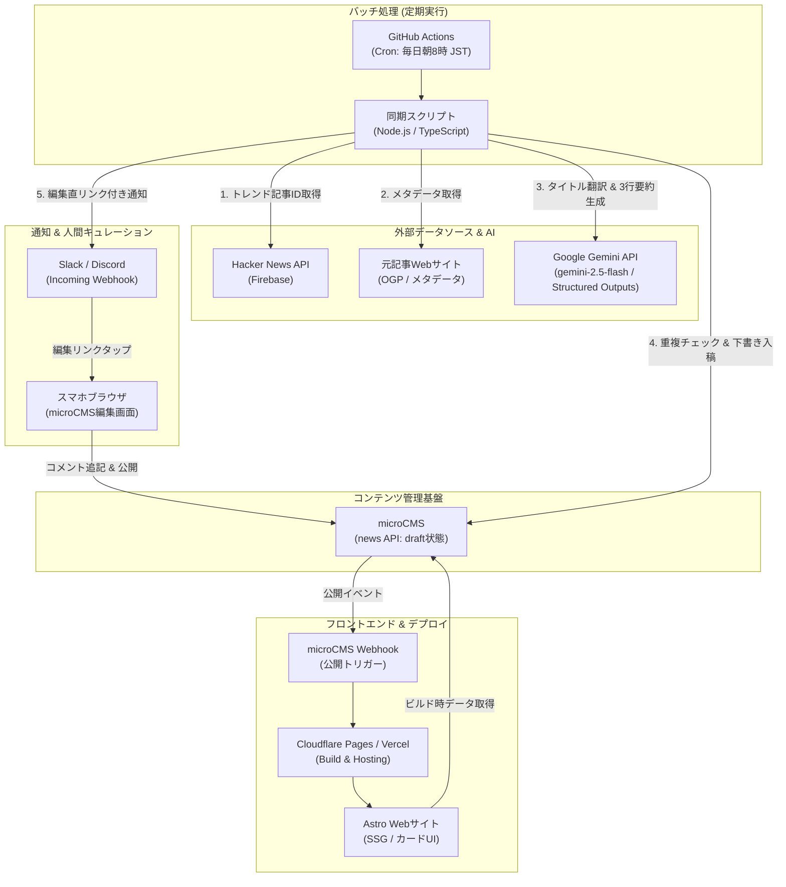
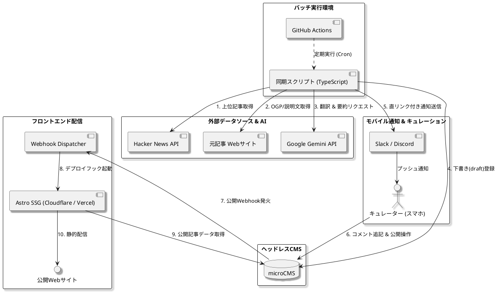
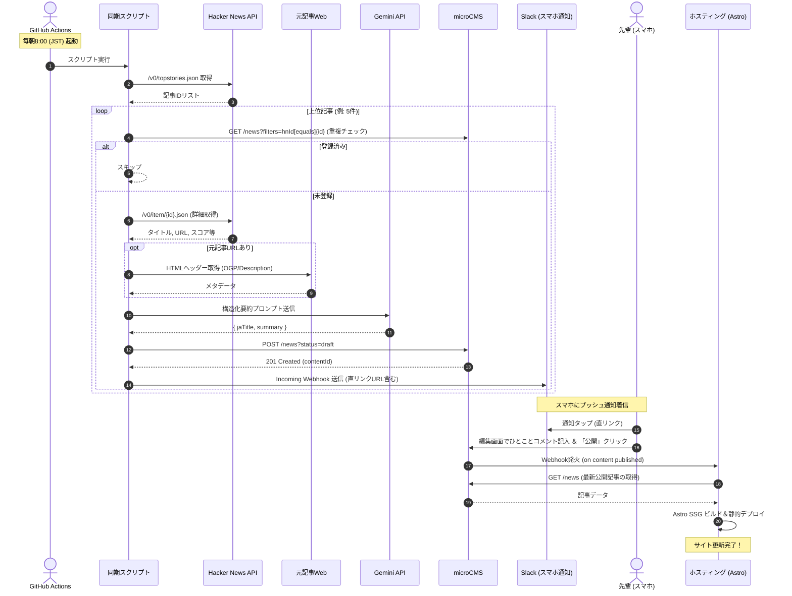
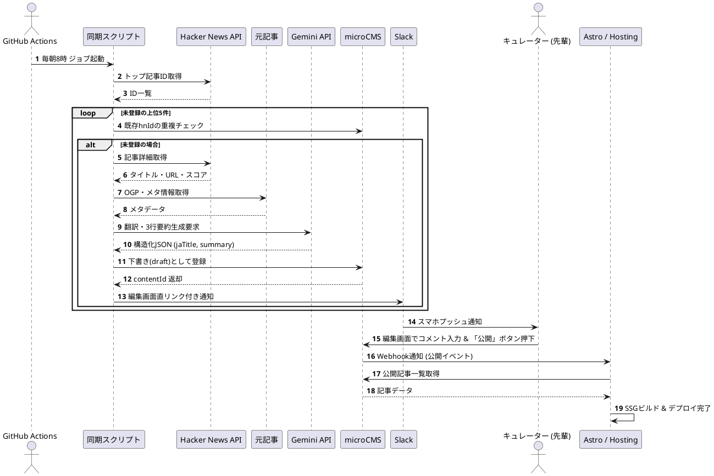

# システム全体アーキテクチャ設計書 (hnmc)

本ドキュメントは、「Hacker News × Gemini API × microCMS × Astro」を統合した半自動テックニュース・キュレーションメディアの全体設計をまとめたものである。

---

## 1. システム概要

毎朝Hacker Newsのトレンド記事を自動取得し、Gemini APIで日本語要約を生成した上でmicroCMSに下書きとして登録する。
登録完了時にSlack（またはDiscord）へ通知を飛ばし、ユーザーがスマホからワンタップでmicroCMSの編集画面を開いてひとことコメントを添えて公開できる半自動キュレーション基盤である。
記事公開時はWebhook経由でAstro（SSG）が自動ビルド＆デプロイされ、高速なWebサイトとして閲覧可能になる。

---

## 2. 全体アーキテクチャ図

### Mermaid 図（GitHub / Qiita ネイティブ対応）

### PlantUML 図

---

## 3. 処理シーケンス図

### Mermaid シーケンス図

### PlantUML シーケンス図

---

## 4. microCMS スキーマ設計 (`news` API)

| フィールドID | 表示名 | 種類 | 必須 | 備考 |
|---|---|---|:---:|---|
| `hnId` | Hacker News ID | テキストフィールド | ○ | 重複入稿防止キー（一意） |
| `title` | 原題タイトル | テキストフィールド | ○ | 英語の元タイトル |
| `jaTitle` | 日本語タイトル | テキストフィールド | ○ | Geminiによる翻訳タイトル |
| `aiSummary` | AI要約 | テキストエリア | ○ | Geminiによる3行箇条書き要約 |
| `url` | 記事URL | テキストフィールド | ○ | 元記事への外部リンク |
| `score` | スコア | 数字 | ○ | 取得時点のポイント（Points） |
| `comment` | ひとこと解説 | テキストエリア | × | 先輩が公開前に書き込むコメント欄 |

---

## 5. 技術選定と考慮事項

1. **完全無料運用の実現**:
   - GitHub Actions: パブリックリポジトリなら実行無料（プライベートでも月2,000分枠内）
   - Gemini API: `gemini-2.5-flash` 無料枠（1日5件程度ならレート制限・コストともに余裕）
   - microCMS: Hobbyプラン（無料）の範囲内
   - Astro / Cloudflare Pages / Vercel: 無料プラン

2. **堅牢性とセキュリティ**:
   - microCMS APIキーをバッチ用（POST/GET権限）とフロント用（GET限定）で完全分離
   - Gemini APIの Structured Outputs (`responseSchema`) を使用し、JSONパースエラーを防止
   - 元記事スクレイピングはヘッダー（OGP/meta description）のみに絞り、著作権侵害を回避
