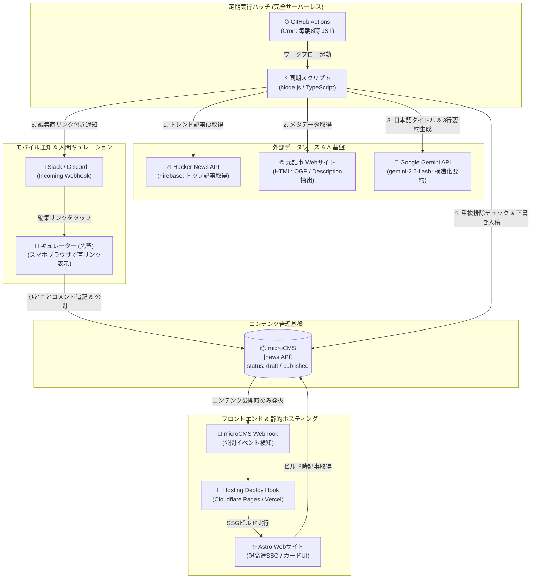
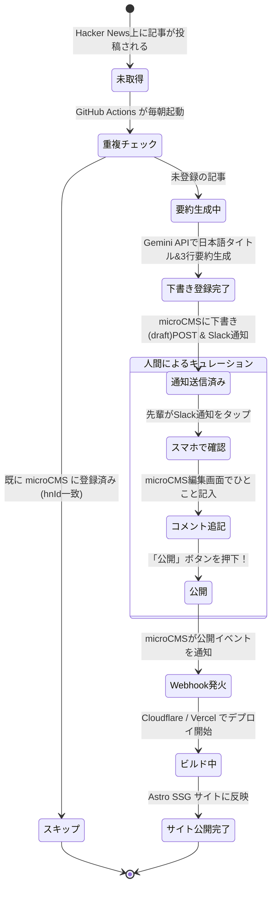
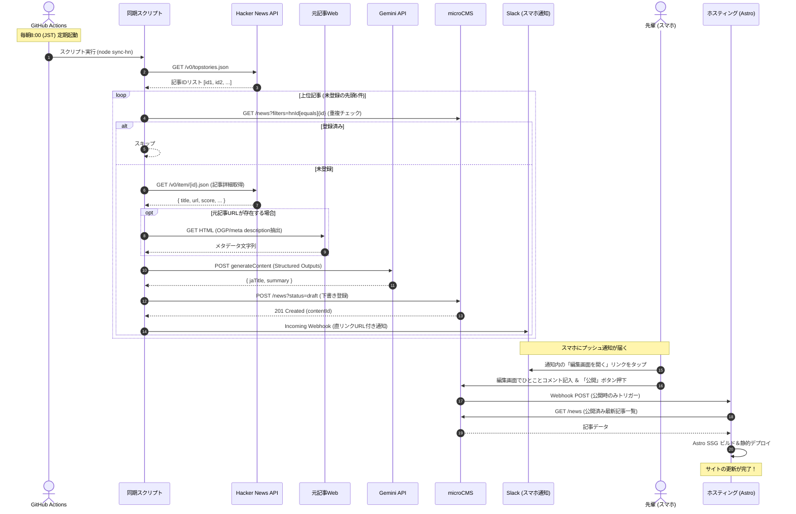
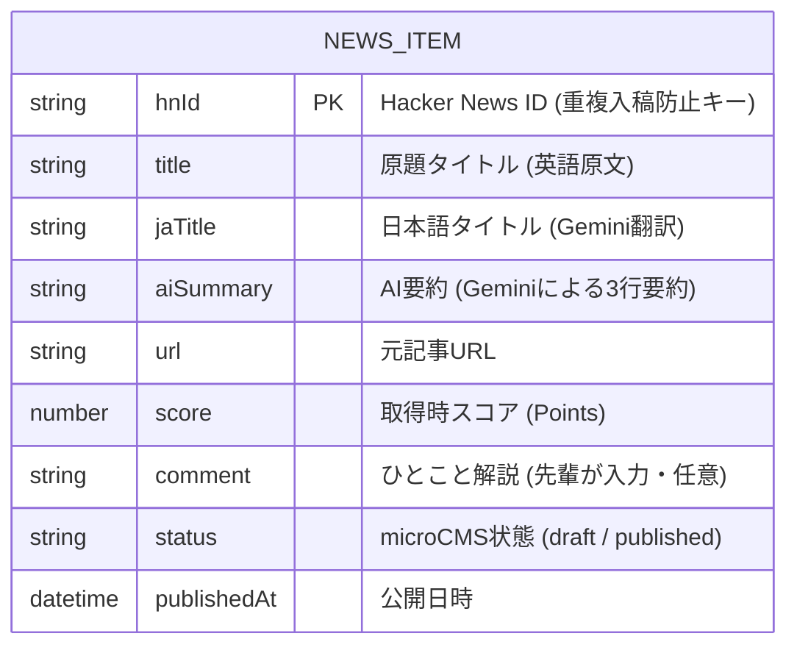

# システム全体アーキテクチャ設計書 (hnmc)

本ドキュメントは、「Hacker News × Gemini API × microCMS × Astro」を統合した半自動テックニュース・キュレーションメディアの全体設計をMermaid図面を中心にまとめたものである。

---

## 1. システム概要

毎朝Hacker Newsのトレンド記事を自動取得し、Gemini APIで日本語要約を生成した上でmicroCMSに下書き（draft）として登録する。
登録完了時にSlack（またはDiscord）へ通知を飛ばし、ユーザーがスマホからワンタップでmicroCMSの編集画面を開いてひとことコメントを添えて公開できる半自動キュレーション基盤である。
記事公開時はWebhook経由でAstro（SSG）が自動ビルド＆デプロイされ、超高速なWebサイトとして世界へ配信される。

---

## 2. システム全体アーキテクチャ図

---

## 3. 記事ライフサイクル（状態遷移図）

---

## 4. 処理シーケンス図

---

## 5. microCMS スキーマ定義（ER図 & 詳細）

| フィールドID | 表示名 | 種類 | 必須 | 備考 |
|---|---|---|:---:|---|
| `hnId` | Hacker News ID | テキストフィールド | ○ | 重複入稿防止キー（一意） |
| `title` | 原題タイトル | テキストフィールド | ○ | 英語の元タイトル |
| `jaTitle` | 日本語タイトル | テキストフィールド | ○ | Geminiによる翻訳タイトル |
| `aiSummary` | AI要約 | テキストエリア | ○ | Geminiによる3行箇条書き要約 |
| `url` | 記事URL | テキストフィールド | ○ | 元記事への外部リンク |
| `score` | スコア | 数字 | ○ | 取得時点のポイント（Points） |
| `comment` | ひとこと解説 | テキストエリア | × | 先輩が公開前に書き込むコメント欄 |

---

## 6. 設計のこだわりポイント

1. **完全Mermaid化**:
   - PlantUML専用サーバーやJava環境に依存せず、GitHub、Qiita、VS Code/IDEで標準レンダリング可能。
2. **スマホ完結のキュレーション体験**:
   - `contentId` を使った直リンク `https://{serviceDomain}.microcms.io/apis/news/{contentId}` により、スマホ通知からワンタップで入力・公開。
3. **安全なスクレイピングと著作権配慮**:
   - 元記事の本文は一切保持せず、ヘッダー（OGP/meta description）のみを取得して要約材料とし、元記事URLへのリンクを明記。
4. **完全無料枠での運用**:
   - GitHub Actions、Gemini 2.5 Flash無料枠、microCMS Hobbyプラン、Cloudflare Pages/Vercelを活用。
