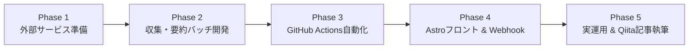

# 開発ロードマップ & TODO一覧 (hnmc)

Qiitaアドベントカレンダー2026（microCMS）への記事投稿をゴールとした、システム構築から公開までの段階的ロードマップである。

---

## 1. 全体スケジュール概要

---

## 2. フェーズ別 TODO リスト

### Phase 1: 基盤準備・外部サービスセットアップ
まずは各外部サービスのアカウント・APIキー・スキーマを用意する。

- [ ] **microCMS の準備**
  - [ ] サービス作成（または既存サービス利用）
  - [ ] リスト形式 API `news` の作成
  - [ ] スキーマ定義（`hnId`, `title`, `jaTitle`, `aiSummary`, `url`, `score`, `comment`）
  - [ ] APIキーの発行と権限分離（バッチ用: `GET` / `POST`、フロント用: `GET` のみ）
- [ ] **Google Gemini API の準備**
  - [ ] Google AI Studio で `GEMINI_API_KEY` を発行
- [ ] **スマホ通知先の準備**
  - [ ] Discord で Webhook URL を発行
- [ ] **GitHub リポジトリ設定**
  - [ ] リポジトリの Secrets に環境変数を登録（`MICROCMS_SERVICE_DOMAIN`, `MICROCMS_API_KEY`, `MICROCMS_WRITE_API_KEY`, `GEMINI_API_KEY`, `DISCORD_WEBHOOK_URL` 等）

---

### Phase 2: 自動収集・AI要約・通知バッチの実装
TypeScript（`tsx` 実行）で、堅牢かつ保守性の高いバッチ処理を実装する。

- [ ] **プロジェクト初期化**
  - [ ] `package.json` / `tsconfig.json` 作成（`tsx`, `neverthrow` 等）
  - [ ] 型安全なエラーハンドリング基盤の構築
- [ ] **各クライアントモジュールの実装**
  - [ ] Hacker News API クライアント（`topstories` & `item` 取得）
  - [ ] 元記事メタデータ抽出（タイムアウト付きで `meta description` / `og:description` を取得）
  - [ ] Gemini API クライアント（`gemini-2.5-flash` + `responseSchema` で日本語タイトル・3行要約生成）
  - [ ] microCMS クライアント（`hnId` での重複チェック & `status=draft` での登録）
  - [ ] Discord 通知クライアント（`contentId` を使った編集画面直リンク `https://{domain}.microcms.io/apis/news/{contentId}` 付きEmbed通知）
- [ ] **テスト & ローカル動作確認**
  - [ ] 単体テスト作成（重複スキップ、パースエラー耐性など）
  - [ ] ローカル環境での実機疎通テスト（下書き登録＆スマホ通知着信まで）

---

### Phase 3: GitHub Actions による定期実行化
サーバーレスで毎朝自動稼働する仕組みを整える。

- [ ] **ワークフロー作成**
  - [ ] `.github/workflows/sync-hn.yml` 作成
  - [ ] `schedule`（毎日朝8:00 JST = `0 23 * * *` UTC）設定
  - [ ] `workflow_dispatch`（手動テスト実行用トリガー）設定
- [ ] **動作検証**
  - [ ] GitHub 上から手動実行してエラーなく完了することを確認
  - [ ] スマホに通知が届き、タップ一発で microCMS 編集画面が開けることを確認

---

### Phase 4: Astro フロントエンド構築 & Webhook連携
microCMS に公開された記事を爆速で配信するサイトを作る。

- [ ] **Astro プロジェクト構築**
  - [ ] Astro プロジェクトセットアップ & `microcms-js-sdk` 導入
  - [ ] `NewsItem` 型定義 & 記事一覧取得ロジック実装
  - [ ] Hacker News 風のカード UI 実装（AI要約ボックス & 先輩のひとことボックス）
- [ ] **ホスティング & 自動デプロイ設定**
  - [ ] Cloudflare Pages へデプロイ
  - [ ] Cloudflare Pages 側の Deploy Hook URL を発行
  - [ ] microCMS 管理画面で Webhook 設定（トリガーを「コンテンツの公開」のみに限定）
- [ ] **E2E 動作確認**
  - [ ] スマホからコメント追記 ➔ 「公開」ボタン押下 ➔ 自動ビルド ➔ 公開サイトへ反映される一連の流れを確認

---

### Phase 5: 実運用チューニング & Qiitaアドベントカレンダー執筆
実際の運用データを元に仕上げを行い、記事としてアウトプットする。

- [ ] **実運用・チューニング**
  - [ ] 数日間運用して要約プロンプトや取得件数を微調整
- [ ] **Qiita 記事執筆**
  - [ ] 記事用のスクリーンショット撮影（microCMS 下書き一覧、スマホ通知、公開サイト）
  - [ ] 構成に沿って記事執筆（アーキテクチャ図・スマホ通知の工夫・著作権配慮・完全無料運用）
  - [ ] アドベントカレンダー公開日に投稿！
